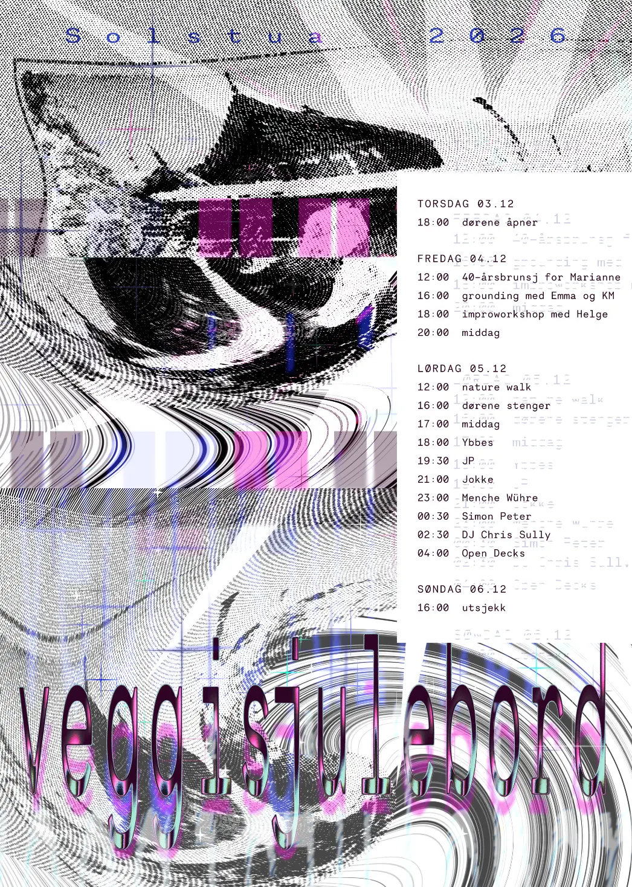

Laget en plakat til en privat musikkfest for venner. Utgangspunktet var arkivbilder fra Solstua, som jeg forvrengte til noe som ser ut som trykkfeil. Oppå der kom tyske julestjerner, og en litt nerdete stemning for oss på festen som er mellom 30 og 40.

Jeg er opptatt av feil og det uperfekte som estetikk. Raster som sklir, farger som ikke treffer hverandre, tekst som dukker opp to ganger. Det er sånt et trykkeri ville kassert, men det viser sporene av prosessen og gir bildet en tekstur en ren flate ikke har. Her fikk feilene være selve uttrykket.
